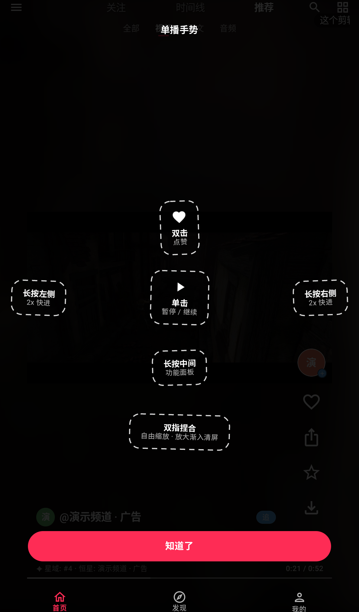
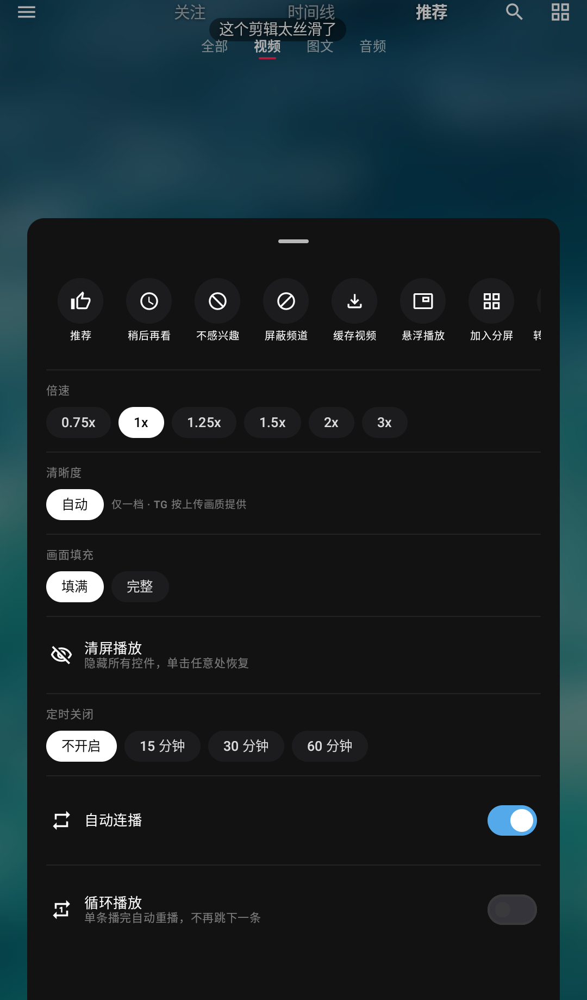
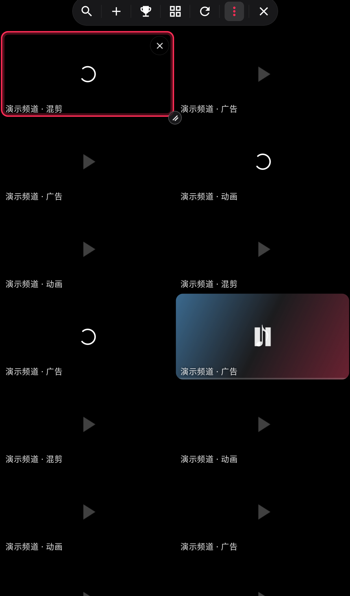
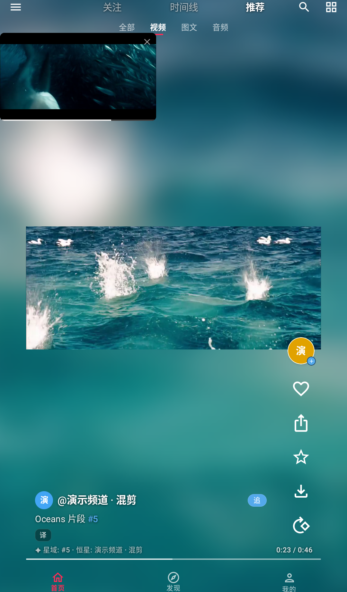
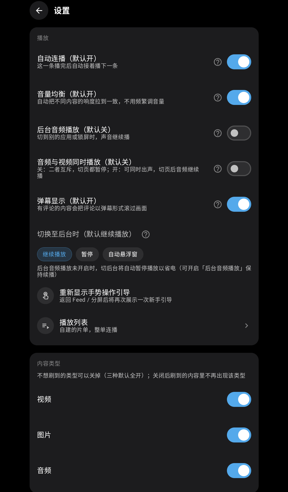
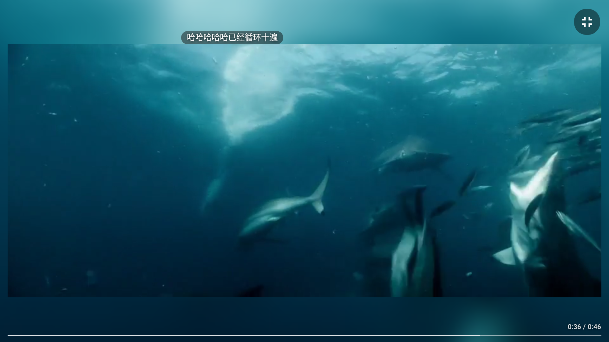

# TGFeed

把 Telegram 频道刷成抖音：沉浸式竖滑视频流、自动播放、播完自动切下一个；
内建「口味星图」——把你的频道宇宙渲染成一张可漫游的星系图。

> **English**: TGFeed turns the Telegram channels you follow into a Douyin/TikTok-style
> vertical video feed — immersive swipe-up browsing, autoplay, auto-advance — plus a
> "taste galaxy": your channel universe rendered as an explorable star map.
> Content comes only from channels **you** have joined, accessed through your own
> Telegram account (TDLib). For learning and personal use only.

## 功能亮点

**内容源**
- 聚合全部频道（并发抓取 + 加权混排推荐）、单频道、服务端搜索（失败自动回退本地过滤）
- 收藏夹、观看历史、稍后再看、订阅追更、频道合集（自建分组一键刷）
- 视频粒度「不感兴趣」黑名单（单条剔除 + 负反馈降权）
- 观看行为本地采集 + 频道权重推荐

**播放**
- 边下边播：内嵌本地流媒体服务器，大视频秒开、支持拖拽
- 分屏模式：无边框网格、格子内 FIT + 模糊底衬、双指捏合切列数、长按拖拽换格
- 悬浮窗：纯画面、宽高比跟随视频、任意多开、独立音量
- 记忆播放位置；预加载分级（下一条整载 + 再下一条只拉前缀，省带宽）
- 硬解失败自动回退软解

**交互（抖音式）**
- 竖滑翻页、播完自动切下一个、单击暂停、双击点赞飘心、长按侧边 2x 快进
- 长按中间弹功能面板（倍速 / 清屏 / 定时关闭 / 自动连播 / 稍后再看 / 悬浮）
- 可拖拽进度条、#话题可点搜索、横屏全屏

**口味星图（Galaxy）**
- 频道宇宙星系图：星 = 频道（大小 = 观看时长，色系 = 内容构成），连线 = 互链/共现
- 手势漫游（缩放/平移/俯冲进行星世界）、天体分档、OpenGL 实时渲染
- 可导出 Wrapped 风海报；点星试吃直达频道内容

**TG 广场（默认关闭，隐私敏感）**
- 去中心化全站动态：一个公开 Telegram 超级群 = 广场「后端」，零服务器
- 开启后你的「在看 / 点赞 / 弹幕」会以**你的 TG 账号公开发送**到广场群，
  群内所有人（含非本 App 用户）可见发送者身份——开启前请知悉
- 官方广场锁定为 `@tgfeed_stl`（全站用户在同一个群才能互通）；
  正式版（release）只找不建：群不存在时诚实提示，绝不替你建群；
  支持备用广场名（主群不可用时的逃生口，同样只找不建）
- 关闭后停止发送；已发出的消息仍留在群中（可在 Telegram 客户端手动删除）

**其他**
- 应用内可配 SOCKS5 代理
- 登录：手机号 + 验证码 + 两步验证，会话持久化
- 收藏 / 点赞 / 历史 / 订阅全部本地落盘；多设备云端同步（走你自己的收藏夹，仅本人可见）
- 未配置 API 凭证时自动进入**演示模式**（内置公开测试视频，无需登录即可体验竖滑播放）
  - 演示视频为 Blender 基金会开源影片片段（Big Buck Bunny / Sintel / Jellyfish，CC-BY 3.0）

## 界面一览

以下截图均为**演示模式**画面(未配置 API 凭证时自动进入,内置 Blender 基金会开源测试影片,Big Buck Bunny / Sintel / Jellyfish 片段,CC-BY 3.0);星图截图稍后补充。

| 竖滑信息流 | 长按功能面板 |
|:---:|:---:|
|  |  |

| 分屏网格 | 悬浮窗 |
|:---:|:---:|
|  |  |

| 设置 | 横屏全屏 |
|:---:|:---:|
|  |  |

## 构建

### 环境

- JDK 17
- Android SDK（platform-34 + build-tools 34.0.0）
- 无需 Android Studio，命令行即可构建

### 1. 配置 `local.properties`

```powershell
copy local.properties.template local.properties
```

编辑 `local.properties`：

- `sdk.dir`：指向你的 Android SDK
- `API_ID` / `API_HASH`：**需要你自己到 <https://my.telegram.org> 申请**（免费，几分钟）
  - 仓库不附带任何凭证；留空则进入演示模式
  - 也可在 App 内「设置」页直接填写，二者等价

### 2. 下载 TDLib 预编译库

首次克隆后执行一次：

```powershell
powershell -File scripts/fetch-tdlib.ps1
```

### 3. 构建与安装

```powershell
# 正式包（R8 混淆 + 资源裁剪）
.\gradlew.bat assembleRelease
# 产物：app\build\outputs\apk\release\app-release.apk
```

**签名（可选）**：把签名件放到项目根 `tgfeed-release.keystore`，并在
`local.properties` 里填 `KEYSTORE_PASSWORD`（与 `KEY_ALIAS`，默认 `tgfeed`）即自动签名；
没有签名件则产出未签名包（可自行用 `apksigner` 事后签）。

## 技术栈

- Kotlin + Jetpack Compose + Media3 (ExoPlayer)
- [TDLib](https://github.com/tdlib/td)（预编译 AAR，构建前经脚本下载，不进本仓库）

## 免责声明

- 本项目仅供学习与技术交流，不提供、不聚合任何内容。
- 所有内容均来自使用者本人 Telegram 账号已加入的频道，经由使用者自己的
  API 凭证访问；请遵守 Telegram 服务条款与当地法律法规。
- 本项目与 Telegram 官方无任何关联，不是 Telegram 官方客户端。

## License

[GPL-3.0](LICENSE) —— GNU General Public License v3.0，全文见 [LICENSE](LICENSE)。
